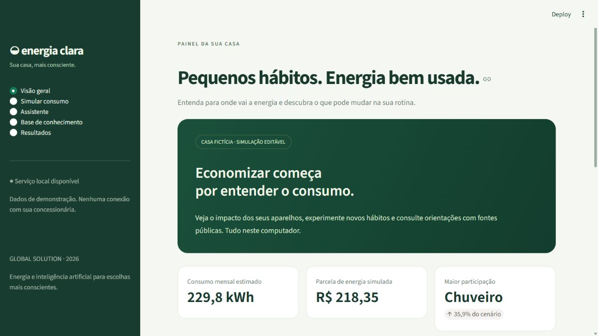

# Energia Clara

**Assistente local de uso consciente de energia residencial.** MVP em Streamlit, API FastAPI, simulação de consumo por CSV e comparação real de SmolLM2 sem contexto, RAG simples e RAG + LoRA. Treinamento feito em CPU neste computador.



**Conferência de 09/11/2026:** artefatos íntegros, mas a revalidação funcional está bloqueada pelo Controle de Aplicativo do Windows ao carregar uma dependência. Consulte a [auditoria e as pendências](docs/AUDITORIA_ENTREGA.md) antes de gravar.

## Abrir a demonstração

Neste computador, dê dois cliques em **`Iniciar_Energia_Clara.bat`**. A interface abre em [127.0.0.1:8501](http://127.0.0.1:8501). Para encerrar os dois serviços gerenciados por esse atalho, use **`Parar_Energia_Clara.bat`**.

- **Visão geral:** consumo estimado e participação dos aparelhos da casa fictícia.
- **Simular consumo:** importar CSV, editar hábitos e comparar cenários.
- **Assistente:** consulta documental recomendada; três modos de geração identificados como experimentais.
- **Base de conhecimento:** 30 notas e 11 publicações com proveniência/licença.
- **Resultados:** placar real, curva de validação e evidências do treino.

O CSV de exemplo é `dados/consumo_exemplo.csv`. As potências, tempos, tarifa e fatores são hipóteses fictícias e editáveis. O cálculo estima a parcela de energia, não o total da fatura. Não envie dados pessoais ou contas reais para a demonstração.

## Resultados reais

| Configuração | Fatos corretos / 40 | Recusas corretas / 20 | Acerto total revisado | Acerto completo revisado |
| --- | --- | --- | --- | --- |
| A — Sem contexto | 0 | 0 | 0.0% | 0.0% |
| B — RAG simples | 20 | 8 | 46.67% | 13.33% |
| C — RAG + LoRA | 1 | 11 | 20.0% | 18.33% |

A revisão não confirmou o ganho factual sugerido pelo corretor automático. O RAG simples preservou mais fatos essenciais do que LoRA, mas falhou no contrato JSON. LoRA melhorou o formato e parte das recusas, ao custo de conteúdo incoerente em fatos não usados no treino. O treinamento e a comparação foram realizados; a especialização não atingiu qualidade factual adequada para uso livre. Por isso, o MVP recomenda consulta documental direta, que apresenta as notas e fontes sem paráfrase da LLM. Os três modos de geração continuam disponíveis como experimento. Essa decisão de produto é posterior à avaliação e não foi contabilizada como desempenho da LLM.

**Limite da medida:** a tabela acima usa revisão semântica assistida por IA, sem alegar revisão humana independente. O corretor automático inicial teve falsos positivos/negativos e foi preservado para auditoria. Seu indicador operacional não deve ser tratado como uma taxa comprovada de alucinação. Há 40 perguntas respondíveis de 10 grupos factuais correlacionados e 20 sem resposta na base. Formato, recuperação, recusa e fundamentação são medidos separadamente.

Leia o [relatório completo](RELATORIO.md), o [placar detalhado](avaliacao/placar.csv) e os [cinco erros reais](avaliacao/cinco_erros.json).

## Preparar em outro computador

Ambiente testado: Windows, Python 3.14.7, CPU e 16 GB de RAM. Os comandos são executados na pasta deste repositório. Internet é necessária para instalar bibliotecas e baixar os modelos; depois, a inferência é local.

```powershell
py -3.14 -m venv .venv
.\.venv\Scripts\python.exe -m pip install --upgrade pip
.\.venv\Scripts\python.exe -m pip install torch==2.13.0 --index-url https://download.pytorch.org/whl/cpu
.\.venv\Scripts\python.exe -m pip install -r requirements.lock.txt
.\.venv\Scripts\python.exe -m scripts.baixar_recursos --apenas-modelos
.\.venv\Scripts\python.exe -m scripts.servicos iniciar
```

O modelo original e o encoder foram excluídos do Git. `modelos/revisoes.json` fixa as revisões e os hashes; o comando de download reaproveita essas revisões. O adaptador treinado está em `modelos/adaptador/`. Não é necessário treinar novamente para usar a demonstração distribuída.

Os modelos somam aproximadamente 0,75 GB em pesos, além de tokenizadores, bibliotecas e cache. Reserve alguns GB de disco. Em CPU, a primeira pergunta carrega recursos e pode demorar mais. O uso de memória e o tempo efetivamente medidos estão no relatório.

O ambiente já criado nesta máquina reutiliza PyTorch e algumas bibliotecas previamente disponíveis via `--system-site-packages`, sem alterar a instalação global. O roteiro acima cria um ambiente novo e usa o arquivo de versões exportado das dependências efetivamente utilizadas.

## Conferir a entrega existente

Com a API iniciada, execute os testes e a conferência, sem treinar novamente:

```powershell
.\.venv\Scripts\python.exe -m pytest -q --junitxml=avaliacao/testes.xml
.\.venv\Scripts\python.exe -m scripts.verificar_entrega
```

Veja a [auditoria por requisito](docs/AUDITORIA_ENTREGA.md) e o [roteiro do vídeo e envio](docs/ENTREGA_MANUAL.md).

## Reproduzir o experimento

Use uma cópia separada conforme abaixo. Estes comandos geram um novo experimento, cuja revisão semântica precisará ser refeita.

```powershell
.\.venv\Scripts\python.exe -m scripts.preparar_dados
.\.venv\Scripts\python.exe -m scripts.baixar_recursos
.\.venv\Scripts\python.exe -m scripts.treinar_lora --piloto
.\.venv\Scripts\python.exe -m scripts.experimento
.\.venv\Scripts\python.exe -m pytest -q --junitxml=avaliacao/testes.xml
```

`experimento` se recusa a sobrescrever uma avaliação C já existente. Para um novo experimento completo, **copie a pasta do projeto sem os três `avaliacao/resultados_*.jsonl`, `historico_treino.json`, `placar.json` e o adaptador**, ou arquive esses arquivos deliberadamente. Após a nova execução, revise as novas saídas e atualize as anotações e hashes; só então execute `scripts.gerar_relatorio`. Inicie a API com `scripts.servicos iniciar` antes de `scripts.gerar_notebooks --executar`. A revisão distribuída não serve para novos resultados. O roteiro acima descreve uma reprodução limpa; o repositório entregue já contém os resultados. `--continuar` retoma etapas completas/incompletas do mesmo protocolo; não serve para comparar dados ou modelos alterados. Não troque o teste para melhorar o placar publicado.

Os notebooks leem os artefatos reais, verificam suas assinaturas e exibem as saídas; o treinamento longo é feito pelo script próprio, não repetido silenciosamente ao abrir um notebook. O notebook de integração também faz chamadas reais à API local. Os gráficos HTML são autocontidos e não precisam de CDN.

A conferência final foi registrada em [avaliacao/verificacao_entrega.json](avaliacao/verificacao_entrega.json), com os três notebooks executados, 60 saídas por configuração, cinco erros reais e o resultado dos testes registrado em `avaliacao/testes.xml`. Para repetir a checagem dos artefatos sem treinar, execute `.\.venv\Scripts\python.exe -m scripts.verificar_entrega`. O Git preserva os bytes originais para não invalidar os hashes por conversão de quebras de linha.

A revisão semântica distribuída se aplica somente às saídas publicadas, conferidas por hash. Em uma nova execução, é necessário revisar as novas saídas antes de gerar uma nova conclusão; o programa recusa reutilizar a anotação antiga.

O modo offline é o padrão de execução. Apenas `scripts.baixar_recursos` habilita a etapa de obtenção pública. Os snapshots originais ficam fora do Git por direitos/licenças; o corpus distribuído contém notas autorais atribuídas.

## API

Documentação interativa: [127.0.0.1:8000/docs](http://127.0.0.1:8000/docs).

```json
{"pergunta":"Qual posição do chuveiro ajuda a economizar?","configuracao":"lora_rag"}
```

Envie o JSON a `POST /perguntar`. Configurações aceitas: `sem_contexto`, `rag`, `lora_rag`. A resposta contém `status`, `resposta`, `fontes`, evidências, origem da decisão e tempo. `status=erro` identifica falha de formato/fonte; não é uma resposta factual validada. `POST /simular` e `POST /ingerir-consumo` são usados pela própria interface.

O modo recomendado recebe `{"pergunta":"Como economizar energia com o chuveiro?"}` em `POST /consultar-base`. Ele retorna notas literais e suas fontes, com `modelo_chamado=false`. A similaridade pode trazer notas apenas relacionadas; verifique sua pertinência. Isso não substitui nem é contabilizado como geração da LLM treinada.

Serviços limitados ao computador local, sem autenticação pública. O código não é uma implantação de produção e não consulta tarifas atuais. Os limites, medidas de proteção de dados e avaliação estão no relatório.

## Organização

```text
api/               API do produto
energia_clara/     busca, geração, contratos, cálculo e avaliação
scripts/           preparação, download, treino, avaliação e documentação
base/              notas, fontes, licenças e índice local
dados/             consumo fictício de exemplo
avaliacao/         treino/validação/teste, saídas brutas, placar e erros
modelos/           revisões e adaptador LoRA treinado
notebooks/         notebooks executados com saídas
relatorio/         gráficos e capturas da demonstração
tests/             verificações funcionais e de integridade
```

## Equipe

| Integrante | RM |
| --- | --- |
| Davi Passanha de Sousa Guerra | RM551605 |
| Cauã Gonçalves de Jesus | RM97648 |
| Luan Silveira Macea | RM98290 |
| Rui Amorim Siqueira | RM98436 |
| Luigi Ferrara Sinno | RM98047 |

## Publicação e vídeo

Foi preparado somente um **repositório Git local**, sem remoto e sem publicação. O aluno fará o envio manual ao seu GitHub público e gravará o vídeo posteriormente. Não há links externos inventados. O material original das aulas, o ambiente virtual, caches, snapshots das páginas e pesos completos dos modelos não entram no Git.

Código próprio sob [MIT](LICENSE); notas e perguntas sob [CC BY 4.0](base/LICENCA.md); adaptador derivado de SmolLM2 sob [Apache-2.0](modelos/adaptador/LICENCA.md). Os direitos dos documentos de referência são preservados. A base metodológica são as aulas fornecidas da disciplina.
