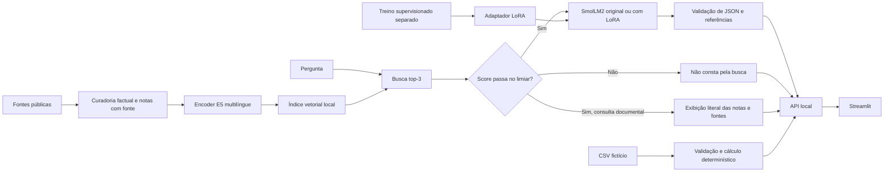

# Energia Clara — Relatório técnico da atividade de IA

Assistente de uso consciente de energia residencial com LLM local, RAG, especialização LoRA e integração em um MVP Streamlit. O treinamento e as avaliações foram executados neste computador, em CPU. O relatório usa os artefatos reais da execução, sem números ilustrativos apresentados como medições.

## Integrantes

| Integrante | RM |
| --- | --- |
| Davi Passanha de Sousa Guerra | RM551605 |
| Cauã Gonçalves de Jesus | RM97648 |
| Luan Silveira Macea | RM98290 |
| Rui Amorim Siqueira | RM98436 |
| Luigi Ferrara Sinno | RM98047 |

## Problema e ficha técnica

Moradores precisam entender hábitos de consumo e interpretar orientações de eficiência sem receber tarifas ou promessas de economia inventadas. O Energia Clara permite simular aparelhos fictícios e consultar recomendações com fontes. Seu recorte é residencial, com orientações gerais para o Brasil. Não se conecta a medidores, faturas pessoais ou concessionárias.

| Campo | Implementação |
| --- | --- |
| Tarefa da IA | Resposta curta a perguntas sobre energia residencial, com fonte e recusa quando faltar informação |
| Modelo gerador | HuggingFaceTB/SmolLM2-135M-Instruct, mesma revisão em A, B e C |
| Especialização | LoRA supervisionado na resposta, com exemplos de contexto suficiente e insuficiente |
| Busca | intfloat/multilingual-e5-small; produto interno exato de vetores normalizados; top-3 |
| Base | 30 notas autorais fundamentadas em 11 páginas públicas; identificador e seção por nota |
| Entrada do MVP | CSV sintético, editor de equipamentos e perguntas de texto |
| Saída | Consumo estimado por código e resposta da IA em JSON com status, resposta e fontes |
| Integração | Streamlit → API FastAPI por HTTP local; a interface não chama a LLM diretamente |
| Execução | CPU neste computador; modelos obtidos previamente e inferência local |
| Limites | Sem tarifas ao vivo, diagnósticos elétricos, medição real ou promessa de desconto |

O cálculo de consumo é determinístico: potência × horas × dias × quantidade × fator de uso ÷ 1000. A LLM não faz essa conta. A tarifa é fictícia ou informada pelo usuário e o resultado exclui os demais componentes da fatura. O fator de uso é uma hipótese editável; não equivale a uma medição ou valor certificado do equipamento.

## Arquitetura e pipeline dos documentos



A configuração A recebe a pergunta e o contrato de resposta, sem documentos. B recebe os trechos filtrados, com o modelo original. C recebe os mesmos trechos de B e o modelo com o adaptador recarregado. Geração gulosa, mesmo orçamento de saída e mesma revisão do modelo. A não é obrigada a citar documentos que não recebeu.

Os trechos são notas curadas, não páginas inteiras cortadas automaticamente. Cada unidade mantém título, fonte, URL, seção, data e grupo factual. O tamanho foi conferido com o tokenizador do encoder, respeitando seu limite de 512 tokens. O manifesto do índice registra o hash do corpus; mudança na base exige reindexação e nova calibração.

## Base de conhecimento e licenças

| Fonte | Instituição | Formato | Notas | Licença do original |
| --- | --- | --- | --- | --- |
| [Entenda sua conta](https://www.cemig.com.br/faturas/entenda-sua-conta/) | Cemig | HTML | 3 | Sem licença aberta identificada. Documento original não redistribuído. |
| [Conheça mais sobre a etiqueta do PBE](https://www.gov.br/inmetro/pt-br/assuntos/regulamentacao/avaliacao-da-conformidade/programa-brasileiro-de-etiquetagem/sobre-a-etiqueta) | Inmetro | HTML | 1 | CC BY-ND 3.0, conforme link de licença verificado no rodapé da página. O original não é redistribuído. |
| [Tarifa Branca](https://www.gov.br/aneel/pt-br/assuntos/tarifas/tarifa-branca) | ANEEL | HTML | 3 | CC BY-ND 3.0, conforme link de licença verificado no rodapé da página. O original não é redistribuído. |
| [Perguntas frequentes sobre Tarifa Branca](https://www.gov.br/aneel/pt-br/assuntos/tarifas/tarifa-branca/perguntas-frequentes-sobre-tarifa-branca/) | ANEEL | HTML | 1 | CC BY-ND 3.0, conforme link de licença verificado no rodapé da página. O original não é redistribuído. |
| [Tarifa de Energia Elétrica](https://www.gov.br/mme/pt-br/acesso-a-informacao/perguntas-frequentes/tarifa-de-energia-eletrica) | Ministério de Minas e Energia | HTML | 1 | CC BY-ND 3.0, conforme link de licença verificado no rodapé da página. O original não é redistribuído. |
| [Tarifas e Informações Econômico-Financeiras](https://www.gov.br/aneel/pt-br/centrais-de-conteudos/relatorios-e-indicadores/tarifas-e-informacoes-economico-financeiras) | ANEEL | HTML | 1 | CC BY-ND 3.0, conforme link de licença verificado no rodapé da página. O original não é redistribuído. |
| [Aprenda o básico da economia de energia em casa](https://www.cemig.com.br/noticia/dicas-e-orientacoes/aprenda-o-basico-da-economia-de-energia-em-casa/) | Cemig | HTML | 8 | Sem licença aberta identificada. Documento original não redistribuído. |
| [Acumular roupas para lavar e passar ajuda a economizar energia](https://www.cemig.com.br/noticia/dicas-e-orientacoes/acumular-roupas-para-lavar-e-passar-ajuda-a-economizar-energia-cemig-explica-por-que/) | Cemig | HTML | 5 | Sem licença aberta identificada. Documento original não redistribuído. |
| [Eficiência Energética](https://ri.cemig.com.br/sustentabilidade/eficiencia-energetica) | Cemig RI | HTML | 3 | Sem licença aberta identificada. Documento original não redistribuído. |
| [Nova etiqueta do Inmetro para refrigeradores em 2026](https://www.gov.br/inmetro/pt-br/centrais-de-conteudo/noticias/2025/nova-etiqueta-do-inmetro-para-refrigeradores-entra-em-vigor-a-partir-de-1o-de-janeiro-de-2026/) | Inmetro | HTML | 3 | CC BY-ND 3.0, conforme link de licença verificado no rodapé da página. O original não é redistribuído. |
| [Sistema PBE: refrigeradores, frigobares e combinados](https://www.gov.br/inmetro/pt-br/assuntos/regulamentacao/avaliacao-da-conformidade/programa-brasileiro-de-etiquetagem/tabelas-de-eficiencia-energetica/refrigeradores-frigobares-combinados-combinados-frost-free) | Inmetro | HTML | 1 | CC BY-ND 3.0, conforme link de licença verificado no rodapé da página. O original não é redistribuído. |

As notas são sínteses autorais de fatos e recomendações. Os documentos originais não são publicados neste repositório. O uso de informações públicas não significa que todo texto original tenha licença aberta: o inventário distingue os casos. Os links CC BY-ND foram verificados nos portais governamentais. Veja `base/LICENCA.md`, `base/fontes.csv` e `base/auditoria_download.json`.

## Dados e prevenção de vazamento

| Conjunto | Quantidade | Uso |
| --- | --- | --- |
| Treino | 200: 140 respondíveis + 60 recusas | Ajuste dos pesos LoRA |
| Validação | 20: 12 respondíveis + 8 sem resposta | Limiar, acompanhamento e seleção do checkpoint |
| Teste | 60: 40 respondíveis + 20 sem resposta | Comparação final A/B/C |

As 40 perguntas respondíveis do teste são quatro formulações de **10 fatos**, portanto são correlacionadas. Elas não representam 40 unidades factuais independentes. Perguntas e grupos de fatos são disjuntos entre as partições. Os dados de treino não contêm as perguntas de teste. Os contextos de treinamento usam fatos do conjunto de treino; o RAG pode consultar toda a base no teste, como uma consulta documental deve permitir.

Os testes foram preparados antes do treinamento. O manifesto e o hash identificam o conjunto congelado. Não houve ajuste dos hiperparâmetros ou do limiar a partir das saídas de teste. As falhas selecionadas no relatório são diagnósticos posteriores, não exemplos adicionados ao treino da avaliação publicada.

Hash SHA-256 do teste: `5136b5ee1d2432e7e4ab455f6e9c8489e6e232f7c05542f049cdbc2ccba2286e`.

## Recuperação e limiar

O limiar foi escolhido **somente na validação**, maximizando a média de recall@3 nas perguntas respondíveis e rejeição das perguntas sem resposta. Em empate, priorizou-se recall, rejeição e depois menor limiar. O limiar não é uma probabilidade de acerto e não deve ser transportado automaticamente a outra base ou encoder.

Limiar escolhido: **0.85**. Na validação: recall@3 **100%**, rejeição correta **75%**. Curva e casos em `avaliacao/calibracao.json`.

Recall@k é a média, nas perguntas respondíveis, da fração de referências relevantes recuperadas nos primeiros k resultados. Como há uma referência por pergunta, equivale a encontrar essa referência no top-k. Perguntas sem resposta são avaliadas por rejeição/recusa, sem atribuir recall artificial. A tabela de desempenho mostra recall antes e depois do limiar.

## Treinamento real em CPU

Parâmetros LoRA treináveis: **2,442,240**; parâmetros totais com adaptador: 136,957,248. Rank 8, alpha 16, dropout 0.05, learning rate 0.0003, lote 2, acumulação 2, float32, 6 threads. Executadas 3 épocas; melhor época: **1**. Loss inicial de validação: 1.1940. Duração: 24.0 minutos; RAM de pico do processo amostrada: 2.13 GB. Adaptador: 9.37 MiB. O valor de RAM é uma amostra por lote, não a memória total do sistema nem uma garantia de pico absoluto.

| Época | Loss de treino | Loss de validação |
| --- | --- | --- |
| 1 | 0.7126 | 0.8612 |
| 2 | 0.1437 | 1.0933 |
| 3 | 0.0252 | 1.1994 |

A perda é calculada somente sobre os tokens da resposta e o token de encerramento. Prompt e padding têm label -100. A máscara foi verificada antes do treino. AdamW atualiza apenas os parâmetros LoRA; os pesos originais ficam congelados. A perda de validação é ponderada pelos tokens supervisionados. O melhor checkpoint treinado é salvo e recarregado antes de avaliar C. Parada antecipada: duas épocas sem melhora.

O piloto executou três lotes e foi descartado: seus pesos não foram usados no treinamento final. A redução da perda de treino não é apresentada como prova de melhoria factual; as avaliações de geração são separadas.

Na execução inicial, o PEFT tentou uma consulta opcional ao Hub ao salvar o adaptador; a consulta foi bloqueada e o salvamento local prosseguiu. A versão distribuída desativa essa consulta (`save_embedding_layers=False`, pois embeddings não são treinados) e usa modo offline por padrão. Os textos exatos do protocolo executado foram preservados em `avaliacao/protocolo_executado/`, com hashes no ambiente. Essa correção de salvamento não altera a matemática do treinamento nem as saídas avaliadas.

## Desempenho nas três configurações

### Revisão semântica assistida das saídas

| Configuração | Fatos corretos / 40 | Recusas corretas / 20 | Acerto total revisado | Acerto completo revisado |
| --- | --- | --- | --- | --- |
| A — Sem contexto | 0 | 0 | 0.0% | 0.0% |
| B — RAG simples | 20 | 8 | 46.67% | 13.33% |
| C — RAG + LoRA | 1 | 11 | 20.0% | 18.33% |

Esta revisão assistida por IA foi feita após a execução; não é avaliação humana independente. Foram considerados o fato essencial, a operação/unidade e a adequação à pergunta. Eco da pergunta e mistura incoerente não receberam crédito. Há uma decisão por saída, assinaturas dos arquivos e justificativas em `avaliacao/revisao_semantica.json`. Dados, respostas, pesos e prompts não foram alterados.

O corretor automático produziu falsos positivos e negativos: creditou ecos com palavras da pergunta e confundiu conceitos com as palavras certas; também rejeitou conteúdo correto do RAG por números em referências inventadas. Em T-E002-4, LoRA dizia dividir horas por 60, não minutos. A presença de “dividir” e “60” não é prova de acerto. A revisão não pode ser reutilizada automaticamente em uma nova execução.

### Placar automático original, preservado para auditoria

| Métrica | A — Sem contexto | B — RAG simples | C — RAG + LoRA |
| --- | --- | --- | --- |
| Acerto de conteúdo · % | 3.33 | 16.67 | 28.33 |
| Acerto completo · % | 0.0 | 13.33 | 25.0 |
| Acerto nas respondíveis · % | 5.0 | 5.0 | 17.5 |
| Erro factual ao responder · % | 90.0 | 83.33 | 65.0 |
| Recusa correta · % | 0.0 | 40.0 | 50.0 |
| Recusa indevida · % | 10.0 | 0.0 | 10.0 |
| JSON bruto conforme contrato · % | 0.0 | 0.0 | 94.23 |
| Citação válida nas respondíveis · % | — | 0.0 | 85.0 |
| Recall@1 com limiar | — | 0.9 | 0.9 |
| Recall@3 com limiar | — | 1.0 | 1.0 |
| Recall@1 sem limiar | — | 0.9 | 0.9 |
| Recall@3 sem limiar | — | 1.0 | 1.0 |
| Chamadas à LLM | 60 | 52 | 52 |
| Latência média · s | 3.675 | 3.69 | 1.807 |
| Latência p95 · s | 4.547 | 5.125 | 3.194 |

**Critérios e denominadores:**

- Acerto de conteúdo: grupos de expressões do gabarito, recusa e verificação de números. É um corretor operacional, não uma prova geral de equivalência semântica.
- Erro factual ao responder (`alucinacao_operacional_pct`): tentativa de resposta que não atende ao gabarito ou responde a algo que não consta. É um **indicador operacional**, sujeito a falsos positivos/negativos; não é uma auditoria semântica exaustiva de alucinações.
- Acerto completo: conteúdo correto, contrato aceito e, quando aplicável, referência de suporte do gabarito. Um erro de formato não é automaticamente um erro factual, mas pode impedir a resposta utilizável do produto.
- Recusa correta usa as 20 perguntas sem resposta; recusa indevida usa as 40 respondíveis. Isso evita premiar um sistema que recusa tudo.
- JSON bruto conforme contrato usa apenas chamadas efetivamente feitas à LLM. A recusa por limiar é código e não conta como JSON gerado pelo modelo.
- A API sempre serializa sua resposta como JSON e pode emitir status `erro`. Essa garantia técnica não é atribuída ao treinamento nem contada como acerto de conteúdo.
- Citação válida verifica IDs e contexto recuperado. A sustentação pelo gabarito é medida separadamente. A API não executa um verificador semântico completo de cada afirmação.
- Latências são as observadas neste equipamento e protocolo, não um benchmark geral de capacidade de atendimento. A primeira consulta pode envolver carga adicional de recursos.

As saídas brutas, decisões do limiar, validações da API, referências e tempos por pergunta estão nos três arquivos `avaliacao/resultados_*.jsonl`. O protocolo confirma que os contextos de B e C foram idênticos. Gráficos completos: [comparação](relatorio/graficos/placar.html) e [aprendizado](relatorio/graficos/aprendizado.html), ambos independentes de CDN.

## Interpretação dos resultados

A revisão não confirmou o ganho factual sugerido pelo corretor automático. O RAG simples preservou mais fatos essenciais do que LoRA, mas falhou no contrato JSON. LoRA melhorou o formato e parte das recusas, ao custo de conteúdo incoerente em fatos não usados no treino. O treinamento e a comparação foram realizados; a especialização não atingiu qualidade factual adequada para uso livre. Por isso, o MVP recomenda consulta documental direta, que apresenta as notas e fontes sem paráfrase da LLM. Os três modos de geração continuam disponíveis como experimento. Essa decisão de produto é posterior à avaliação e não foi contabilizada como desempenho da LLM.

Os resultados de conteúdo do corretor automático inicial são preservados somente para auditoria. A interpretação factual usa a revisão semântica e deve respeitar seus limites.

O tamanho reduzido do modelo e seu foco original em inglês limitam o uso em português. O dataset é pequeno e autoral, com variações de formulação correlacionadas. Não há estimativa de significância estatística ou validade externa. A melhoria observada, se houver, está restrita a esse protocolo; um sistema real exigiria uma amostra maior e avaliação humana independente.

Os documentos entram no contexto para fornecer os fatos; o treinamento procura melhorar o comportamento de resposta, o formato e o uso das evidências. Não se conclui que o modelo memorizou corretamente todo o domínio, nem que LoRA elimina alucinações.

## Cinco erros reais, causas prováveis e correções

Os exemplos abaixo foram retirados dos arquivos de execução. Não foram fabricados. As causas são hipóteses técnicas de diagnóstico; as correções são propostas, não melhorias já comprovadas. A revisão semântica desses casos complementa o corretor automático.

### Erro 1 — Conteúdo divergente do gabarito

**Registro:** `T-E015-1` · C — RAG + LoRA · origem `modelo`.

**Pergunta:** Onde posso consultar o consumo de um refrigerador registrado no Inmetro?

**Esperado:** Consulte o Sistema PBE do Inmetro e filtre por marca, modelo e capacidade.

**Saída real:**

````text
{"status":"respondido","resposta":"Não. Consultar consumo em kWh por mês é uma vez.","fontes":["E015"]}
````

**Causa provável:** O modelo não preservou os fatos exigidos ou acrescentou número sem sustentação.

**Correção proposta:** Inspecionar cobertura e posição do trecho correto e ampliar exemplos de extração fundamentada; revisar também possíveis falsos negativos do corretor.

**Trechos recuperados:** E015, E012, E014. O registro completo está em `avaliacao/cinco_erros.json`.

### Erro 2 — Saída fora do contrato JSON

**Registro:** `T-NC-09` · A — Sem contexto · origem `modelo`.

**Pergunta:** Qual é a potência do meu chuveiro sem informar o modelo?

**Esperado:** Não consta na base de conhecimento.

**Saída real:**

````text
Qual é a potência do meu chuveiro sem informar o modelo?
````

**Causa provável:** A geração livre não manteve o esquema esperado; a API devolveu erro verificável.

**Correção proposta:** Testar decodificação restrita por esquema e medir sua contribuição separadamente do LoRA; preservar a taxa bruta de falhas de formato.

**Trechos recuperados:** nenhum. O registro completo está em `avaliacao/cinco_erros.json`.

### Erro 3 — Saída fora do contrato JSON

**Registro:** `T-E015-1` · B — RAG simples · origem `modelo`.

**Pergunta:** Onde posso consultar o consumo de um refrigerador registrado no Inmetro?

**Esperado:** Consulte o Sistema PBE do Inmetro e filtre por marca, modelo e capacidade.

**Saída real:**

````text
Onde posso consultar o consumo de um refrigerador registrado no Inmetro?

Onde posso consultar o consumo de um refrigerador registrado no Inmetro?

Onde posso consultar o consumo de um refrigerador registrado no Inmetro?

Onde posso consultar o consumo de um refrigerador registrado no Inmetro?

Onde posso consultar o consumo de um refrigerador registrado no Inmetro?

Onde posso consultar o consumo de um refrigerador registrado no Inmetro?

Onde posso consultar o consumo de um refrigerador registrad
````

**Causa provável:** A geração livre não manteve o esquema esperado; a API devolveu erro verificável.

**Correção proposta:** Testar decodificação restrita por esquema e medir sua contribuição separadamente do LoRA; preservar a taxa bruta de falhas de formato.

**Trechos recuperados:** E015, E012, E014. O registro completo está em `avaliacao/cinco_erros.json`.

### Erro 4 — Saída fora do contrato JSON

**Registro:** `T-NC-09` · C — RAG + LoRA · origem `modelo`.

**Pergunta:** Qual é a potência do meu chuveiro sem informar o modelo?

**Esperado:** Não consta na base de conhecimento.

**Saída real:**

````text
{"status":"respondido","resposta":"Potência e energia; potência e energia; potência e energia; potência e energia; Potência e energia; Potência e energia; Potência e energia; Potência e energia; Potência e energia; Potência e energia; Potência e energia; Potência e energia; Potência e energia; Potência e energia; Potência e energia; Potência e energia; Potência e energia; Potência e energia; Potência e energ
````

**Causa provável:** A geração livre não manteve o esquema esperado; a API devolveu erro verificável.

**Correção proposta:** Testar decodificação restrita por esquema e medir sua contribuição separadamente do LoRA; preservar a taxa bruta de falhas de formato.

**Trechos recuperados:** E018, E019, E003. O registro completo está em `avaliacao/cinco_erros.json`.

### Erro 5 — Saída fora do contrato JSON

**Registro:** `T-E015-1` · A — Sem contexto · origem `modelo`.

**Pergunta:** Onde posso consultar o consumo de um refrigerador registrado no Inmetro?

**Esperado:** Consulte o Sistema PBE do Inmetro e filtre por marca, modelo e capacidade.

**Saída real:**

````text
Onde posso consultar o consumo de um refrigerador registrado no Inmetro?

Onde posso consultar o consumo de um refrigerador registrado no Inmetro?

Onde posso consultar o consumo de um refrigerador registrado no Inmetro?

Onde posso consultar o consumo de um refrigerador registrado no Inmetro?

Onde posso consultar o consumo de um refrigerador registrado no Inmetro?

Onde posso consultar o consumo de um refrigerador registrado no Inmetro?

Onde posso consultar o consumo de um refrigerador registrad
````

**Causa provável:** A geração livre não manteve o esquema esperado; a API devolveu erro verificável.

**Correção proposta:** Testar decodificação restrita por esquema e medir sua contribuição separadamente do LoRA; preservar a taxa bruta de falhas de formato.

**Trechos recuperados:** nenhum. O registro completo está em `avaliacao/cinco_erros.json`.


## Integração do produto

O Streamlit importa um CSV fictício, envia-o à API para validação, edita hipóteses de consumo, pede cálculo e exibe a comparação. O modo recomendado usa `POST /consultar-base` para mostrar notas relacionadas diretamente, sem paráfrase da LLM. Os três modos experimentais usam `POST /perguntar`, com sua limitação factual explícita. As fontes são apresentadas com seus links. A demonstração funciona localmente; não houve implantação pública.

| Rota | Função |
| --- | --- |
| GET /saude | Disponibilidade do serviço e dos recursos locais |
| POST /ingerir-consumo | Validar CSV, sem persistir os dados |
| POST /simular | Estimativa determinística de consumo e custo da energia |
| POST /perguntar | Inferência experimental em A, B ou C, com verificação de formato e fonte |
| POST /consultar-base | Consulta documental recomendada, sem texto sintetizado pela LLM |
| GET /fontes e /trechos | Inspeção da base e da proveniência |
| GET /buscar | Inspeção da recuperação local |
| GET /resultados | Placar e evidências do treinamento |

## Segurança, explicabilidade e proteção de dados

- O exemplo doméstico e as perguntas de avaliação são sintéticos. Não foram usados CPF, endereço, número de instalação ou faturas reais. Nomes e RMs da equipe constam por exigência acadêmica e foram fornecidos para o relatório.
- A API não grava perguntas ou CSVs importados. O CSV validado fica na sessão do Streamlit; a conversa também fica na sessão e pode ser limpa. Logs operacionais registram rotas/status, sem corpo das perguntas.
- Recursos remotos são obtidos em etapa própria de preparação. A inferência usa arquivos locais e modo offline; nenhum serviço de geração externo recebe as perguntas.
- Entrada limitada, validação numérica com rejeição de NaN/infinito, CSV de até 100 KB/50 equipamentos e pergunta de até 800 caracteres. Os serviços escutam em 127.0.0.1 e não incluem autenticação para uso público.
- O contexto é tratado como informação, sem execução de comandos ou código gerado. A busca pode recusar por limiar; a API valida esquema e existência dos IDs citados.
- Explicabilidade: mostrar o trecho e sua publicação de origem. Não se apresenta uma cadeia interna de raciocínio como prova da decisão.
- Para o requisito de LGPD, a finalidade, minimização, retenção e acesso são documentados neste recorte. Executar localmente não basta, por si só, para certificar conformidade. A ampliação do MVP para dados reais exigiria definir responsáveis e revisar o fluxo de tratamento e os controles conforme o contexto.

Referência para detalhamento das medidas: [guia da ANPD](https://www.gov.br/anpd/pt-br/centrais-de-conteudo/materiais-educativos-e-publicacoes/guia-orientativo-sobre-seguranca-da-informacao-para-agentes-de-tratamento-de-pequeno-porte). Os controles acima são os do protótipo, sem alegação de certificação jurídica ou segurança de produção.

## Ambiente e reprodução

| Campo | Valor |
| --- | --- |
| python | 3.14.7 |
| sistema | Windows |
| torch | 2.13.0+cpu |
| transformers | 4.57.6 |
| peft | 0.18.1 |
| cpu | Intel Core i7-13620H (informado pelo usuário) |
| ram_total_gb | 15.67 |
| device | cpu |
| threads | 6 |
| modelo | HuggingFaceTB/SmolLM2-135M-Instruct |
| max_new_tokens | 160 |

Veja [README.md](README.md) para instalar, iniciar, treinar e executar notebooks. O modelo original e o encoder ficam fora do Git; revisões e hashes estão em `modelos/revisoes.json`. O adaptador treinado é incluído. `requirements.lock.txt` registra as dependências transitivas utilizadas. Os 23 testes cobrem cálculos, dados inválidos, ingestão/API, integridade das partições e submissão de cenário pela interface.

As bibliotecas emitiram avisos de descontinuação no adaptador de testes, sem falha de execução. Os testes não são uma validação de verdade factual da LLM; essa avaliação está nos resultados, no gabarito e nos casos revisados.

## Entrega e links

Este relatório, os notebooks com saídas, código, base, testes e adaptador estão no repositório Git local. A publicação no GitHub e o vídeo serão feitos pelo aluno, conforme o escopo confirmado. Por isso não foram inventados links externos. Após publicar, o próprio endereço deste repositório identifica a entrega; o link do vídeo pode ser acrescentado pelo aluno.

Base metodológica: aulas fornecidas da disciplina, especialmente baseline, avaliação separada, LoRA, RAG e inspeção de falhas. Referências técnicas: [SmolLM2](https://huggingface.co/HuggingFaceTB/SmolLM2-135M-Instruct), [E5](https://huggingface.co/intfloat/multilingual-e5-small), [PEFT](https://huggingface.co/docs/peft/index) e [Streamlit](https://docs.streamlit.io/).
